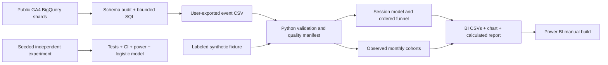

# Architecture

Local package separates cleaning, analytical models, experiment analysis and CLI orchestration. Notebooks reuse the package. Databricks source notebook embeds the fixture and pandas logic so cloud credentials and repository filesystem paths are unnecessary. It demonstrates the same workflow but is not a verified deployed integration. SQL handles nested source structure before local ingestion; item queries remain separate. Large extracts should be aggregated in the warehouse rather than loaded unbounded into pandas.
