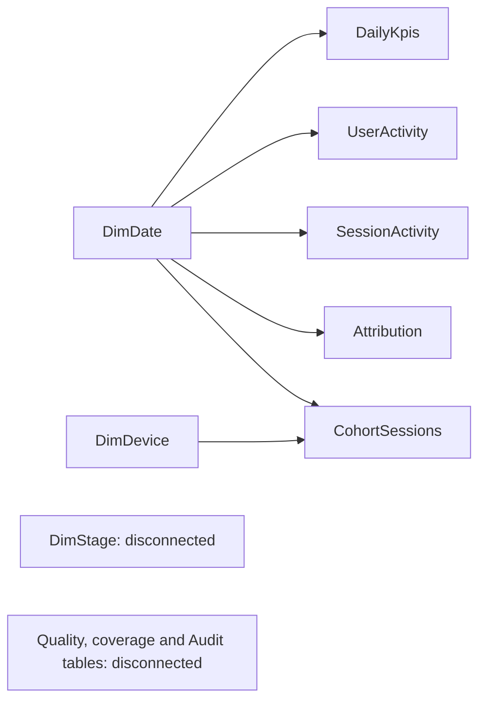

# Power BI Desktop implementation guide

This is an import package and a report design, not a completed Power BI report. No `.pbix` was created or tested. Python checks validate CSV data and intended filter semantics; the DAX expressions and visual interactions still require Power BI Desktop verification.

## Prepare the package

From the repository root, run the existing environment:

```powershell
.\.venv\Scripts\python.exe -m productpulse.dashboard_export
```

The generated package is `powerbi/data/ga4_20210101_07/`. Existing package directories are protected; to regenerate, pass `--output powerbi/data/NEW_real_package`. This reuses private verified source data and makes no BigQuery requests. A fresh checkout needs the real verified data first; synthetic fixtures cannot substitute. `manifest.json` labels the source `REAL_GA4_PUBLIC_SAMPLE` and records input/output hashes, keys, row counts and local checks. This is provenance evidence, not cryptographic proof that a file came from Google.

## Import and type the tables

1. Open Power BI Desktop and create a blank report. Save your eventual report as `ProductPulse.pbix` only after the acceptance checks below. See Microsoft's [Desktop getting-started workflow](https://learn.microsoft.com/power-bi/create-reports/tutorial-end-to-end-power-bi) if Desktop is unfamiliar.
2. Disable automatic relationship detection for this file before loading; remove any relationships already inferred. We will explicitly create single-direction relationships.
3. Use **Get data > Text/CSV > Transform Data** for the files below. Choose UTF-8 encoding, comma delimiter and first-row headers. Remove inferred Changed Type steps. Apply types from `data_dictionary.md`; CSV itself has no types. `import_queries.pq` provides explicit typed query expressions and a reusable loader. Do not combine every file in the folder into one table.
4. Use these exact Power Query/model names, since the DAX file references them:

| CSV | Model table | Load/use |
|---|---|---|
| dim_date.csv | DimDate | Shared seven-day calendar |
| dim_device.csv | DimDevice | Entry-device dimension for cohort only |
| dim_stage.csv | DimStage | Disconnected four-stage visual axis |
| daily_kpis.csv | DailyKpis | Calendar activity, event/missing attribution counts |
| cohort_sessions.csv | CohortSessions | Filterable observed-entry cohort fact |
| user_activity.csv | UserActivity | Distinct user/date presence; supports filtered user cards |
| session_activity.csv | SessionActivity | Distinct session/date presence; supports active-session cards |
| acquisition_completeness.csv | Attribution | Date/field attribution counts |
| quality_indicators.csv | QualityIndicators | Fixed-window quality and recorded validation |
| data_coverage.csv | DataCoverage | Fixed nine-shard coverage |
| window_kpis.csv | AuditWindowKpis | Disconnected full-window acceptance reference |
| overall_ordered_funnel.csv | AuditOverallFunnel | Disconnected static acceptance reference |
| device_funnel_performance.csv | AuditDeviceFunnel | Disconnected static acceptance reference |
| daily_conversion_trends.csv | AuditDailyTrends | Disconnected static acceptance reference |

5. Load and Apply. Mark `DimDate[date]` as the date table. Set every numeric raw column to **Don't summarize** by default, especially keys, distinct counts and precomputed rates. Hide surrogate keys, raw flag columns, and all four Audit tables from report view after validation. Model measures control numeric aggregation.
6. Sort `DimStage[stage_label]` by `DimStage[stage_order]`. Format percentage measures as `0.00%`, event/session counts as integers with separators, and dates consistently. Preserve blank rates.

## Create only these relationships

All relationships below are active, with one-way filtering from dimension to fact. `DimDate[date]` and `DimDevice[device_category]` are unique and non-null; packaging tests check join fanout and orphan keys. Although daily data has one row per date, explicitly choose **one-to-many** from DimDate and Single direction; do not accept an inferred bidirectional one-to-one relation.

| One side | Many side | Semantics |
|---|---|---|
| DimDate[date] | DailyKpis[activity_date] | Calendar activity date |
| DimDate[date] | UserActivity[activity_date] | Calendar user presence |
| DimDate[date] | SessionActivity[activity_date] | Calendar session presence |
| DimDate[date] | Attribution[activity_date] | Calendar attribution counts |
| DimDate[date] | CohortSessions[entry_date] | Observed entry date, including later context events |
| DimDevice[device_category] | CohortSessions[device_category] | Earliest-event normalized entry device |



Do not relate the facts to one another, even when a date or surrogate key matches. Do not relate DimStage to aggregate tables or the session fact. Do not relate AuditDeviceFunnel to device, or AuditDailyTrends to dates: those are independent reconciliation tables, not the interactive model. Avoid many-to-many and bidirectional relationships. Microsoft's [relationship guidance](https://learn.microsoft.com/en-us/power-bi/transform-model/desktop-create-and-manage-relationships) explains cardinality and filter direction.

The model has no dimension that filters both bridges and sessions by user/session key, so key overlap cannot create a loop or inflate counts. A dimension filter narrows fact rows without multiplying them. Fact-to-fact joins would multiply events, session rows, or stage rows and are prohibited. Separate static aggregates cannot be mixed into fact-level totals.

## Measures and filter behavior

Create each named measure from `measures.dax` separately. The file is a list of measure definitions, not one runnable DAX query. It has not been executed in Desktop. `DIVIDE` with no alternate value preserves undefined denominators as BLANK; see Microsoft's [DIVIDE reference](https://learn.microsoft.com/en-us/dax/divide-function-dax).

Use `Total Events`, `Unique Active Users`, `Eligible Active Sessions`, `Entry Cohort Sessions`, and `Product View to Purchase Conversion` for cards. Label the two session scopes explicitly. Unique users use DISTINCTCOUNT over the user/date presence fact, not SUM of daily unique users. Eligible active sessions use DISTINCTCOUNT over session/date presence. Cohort sessions use COUNTROWS over the unique session fact.

The date slicer applies to calendar activity and, separately, observed cohort entry. A cohort purchase may occur in next-day context. Device only filters CohortSessions. All activity/attribution measures return BLANK if a device filter reaches their context, rather than display an unsupported device-filtered value. On pages with a device slicer, use **Edit interactions > None** for activity and attribution visuals; their titles must say **All devices — calendar activity**. Never add a device column to the activity bridges or infer an activity-device definition from the entry device.

`DimStage` is disconnected. `Stage Sessions` chooses the appropriate session flag; it returns BLANK at multi-stage totals. `Previous Stage Sessions` is blank for the first stage. Summing sessions across funnel stages would count one session repeatedly and is not supported. Use separate measures for each stage and weighted ratios for totals; never average daily/device rates.

Attribution charts must have `attribution_field` on their axis/legend or a single-select source/medium filter. A total across source and medium is intentionally BLANK: the same event can be missing both fields. Completeness is available field values divided by calendar events, not campaign performance. Use independent source and medium bars; do not sum their numerators as unique missing events.

QualityIndicators, DataCoverage and Audit tables are fixed to the original window/context. They ignore slicers by design. Their headings must say **Fixed January 1–7 validation / December 31–January 8 coverage**. No dynamic key finding should quote the full-window 2.31% after filters change without a fixed-window label.

## Desktop acceptance checklist

- No filters: cards must show 245,209 events; 22,847 users; 26,331 eligible active sessions; 26,328 entry cohort sessions; 2.3084728564% ordered conversion (display 2.31%). Funnel is 3,942 / 743 / 190 / 91. Potentially incomplete cohort sessions = 4.
- Full-window device results: desktop 2,321 views / 51 ordered purchases (2.20%); mobile 1,514 / 36 (2.38%); tablet 107 / 4 (3.74%). Compare every stage against AuditDeviceFunnel.
- January 1 only: 22,096 events; 2,160 users; 2,311 eligible active sessions; 2,308 entry cohort sessions; funnel 321 / 63 / 20 / 10 and 3.12% conversion. This does not overwrite or reinterpret the original saved single-day analysis.
- Select multiple dates: users and active sessions must be DISTINCTCOUNT of their respective bridges, not sums of daily cards. All dates reproduce 22,847 and 26,331. Compare per-date funnel rows to AuditDailyTrends.
- Select mobile: cohort views/purchases/conversion update; calendar activity and attribution remain explicitly all-device when interactions are disabled, or blank if filters reach them. Quality and coverage remain fixed. Reset restores baseline.
- Empty cohort filter: no divide-by-zero error; rates are blank. First-stage step conversion/abandonment and multi-stage totals are blank. Do not use "Show as percent of grand total" on stages.
- Attribution source: missing 65,617 / 245,209 = 26.76%, completeness 73.24%. Medium: missing 35,968 / 245,209 = 14.67%, completeness 85.33%. Combined-field totals are blank.
- Confirm no many-to-many relationship, no bidirectional arrows, no automatic joins between fact/aggregate tables, and no visible key columns.
- Verify keyboard navigation, chart alt text, focus/tab order and labels; then save the `.pbix`, capture real screenshots and record Desktop version and acceptance outcomes. These manual checks are currently pending.
